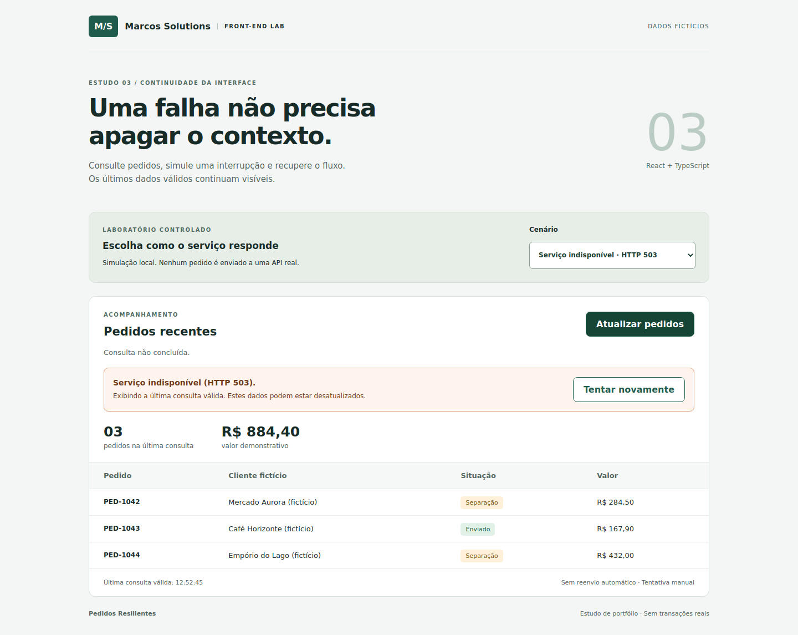

# Resilient Orders — React + TypeScript

A small front-end lab by Marcos Solutions. **Portfolio demonstration, not a production customer system.** All names and orders are fictional.

## Business problem
An operations worker should not lose the last useful order list when a refresh fails. This demo keeps the last valid response visible, marks it as potentially stale, and offers an explicit retry.



## Try it locally
Tested with Node.js 24.22.1 and npm 11.9.0. Dependencies are locked in `package-lock.json`.

```bash
npm ci
npm run dev
```
Open http://127.0.0.1:5173. Select a scenario and click **Atualizar pedidos**. Start with success, switch to HTTP 503, then switch back to success and retry.

```bash
npm run build
npm run preview
npm test
npx playwright install chromium
npm run test:e2e
```
Linux machines may need `npx playwright install --with-deps chromium` to install browser system dependencies.

## Features
- Success, empty result, HTTP 503, malformed payload and slow-response scenarios.
- Explicit 2.5-second timeout and user cancellation using AbortController.
- Last valid orders and their update time survive a failed refresh.
- Manual retry, without automatic request loops.
- Validation of unknown response data before rendering, including duplicate IDs and invalid amounts.
- Labelled native controls, visible focus, live status, error alert and semantic table.
- Responsive layout with horizontal scrolling confined to the table on narrow screens.

## Decisions
`src/api.ts` owns transport, data parsing and error classification. `src/main.tsx` owns UI state. This boundary lets a future real fetch transport replace the simulation without placing request parsing in rendering code.

The mock returns real Response objects but **does not call any external API**. Its delays and HTTP statuses are controlled locally. AbortController cancels pending work; a request generation counter prevents an obsolete result from changing current UI state. Transport implementations must honor the provided AbortSignal, as fetch and this mock do.

The last successful list is separate from loading/error state. Empty success replaces an earlier list with an empty state; failure preserves earlier data. A failed refresh never pretends that stale data is current. Focus is not moved automatically during background refresh; role=status and role=alert communicate changes. Cancellation is treated as a user action, not a server failure.

Currency uses integer-like demonstration amounts formatted as BRL; this is not a financial calculation engine. No state library is needed for this deliberately small screen.

## Structure
- `src/api.ts`: typed model, runtime validation, mock and request lifecycle.
- `src/main.tsx`: page and state transitions.
- `src/style.css`: responsive styles and focus indicators.
- `tests/api.test.ts`: boundary and lifecycle tests.
- `tests/browser/flows.spec.ts`: browser behavior tests.
- `docs/`: actual validation output, Portuguese post and study plan.
- `media/`: real browser captures and demonstration video.

## Verification and limits
See `docs/VALIDATION.md` for the executed results and pending checks. Automated checks do not establish WCAG conformance. Screen-reader testing, Safari/Firefox coverage and a real backend integration remain pending.

No backend, authentication, persistence across reloads, real stock/checkout operations or customer integrations are included. No credentials are required. The GitHub workflow is provided for future use; its execution on GitHub has not been verified here.

Reference: [MDN AbortController.abort](https://developer.mozilla.org/en-US/docs/Web/API/AbortController/abort).
